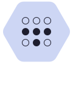

<picture>
  <source media="(prefers-color-scheme: dark)" srcset="assets/banner-dark.svg" />
  <source media="(prefers-color-scheme: light)" srcset="assets/banner-light.svg" />
  
</picture>

### hey, I'm Harry 👋

I build web things, live on Linux, and keep starting hardware projects that end up way bigger than planned. Currently studying software engineering in Avignon, France.

<picture>
  <source media="(prefers-color-scheme: dark)" srcset="assets/workbench-dark.svg" />
  <source media="(prefers-color-scheme: light)" srcset="assets/workbench-light.svg" />
  
</picture>

### stuff I've made

- **[soleur.ai](https://soleur.ai)** — spent my internship on this open-source platform that runs AI agents for solo founders. Ended up touching a bit of everything: front, back, database, CI and a Claude Code plugin.
- **Watchlist** — films, shows, anime and manga in one place, because four apps was three too many.
- **Urbex map** — 84 abandoned spots around Côtes-d'Armor, Brittany, packed into a single HTML file.
- **Nook** — my own clipboard manager for Cinnamon, because I wanted `Super+V` to work my way.

### what I use

  <a href="https://tailscale.com/"><picture><source media="(prefers-color-scheme: dark)" srcset="assets/stack/tailscale-dark.svg" /><source media="(prefers-color-scheme: light)" srcset="assets/stack/tailscale-light.svg" /></picture></a>

### on repeat

<picture>
  <source media="(prefers-color-scheme: dark)" srcset="assets/music-dark.svg" />
  <source media="(prefers-color-scheme: light)" srcset="assets/music-light.svg" />
  
</picture>

### random facts

- I stream on Twitch as Elvalio
- slowly de-googling everything I own
- my coffee setup gets more attention than it deserves

  <picture>
    <source media="(prefers-color-scheme: dark)" srcset="https://streak-stats.demolab.com?user=Elvalio&theme=catppuccin-mocha&hide_border=true&border_radius=10" />
    <source media="(prefers-color-scheme: light)" srcset="https://streak-stats.demolab.com?user=Elvalio&theme=catppuccin-latte&hide_border=true&border_radius=10" />
    
  </picture>

